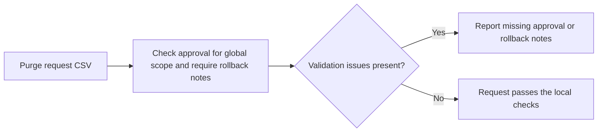

# Edge Cache Purge Validator

A broad cache purge can increase origin traffic. Operators need approval and a rollback note before acting on a global request.

## What I built

I built a preflight validator for CDN purge requests. It requires approval for global scope and a rollback note for every request, then lists all missing requirements by request ID.

## How it works



[Architecture](docs/ARCHITECTURE.md) · [Decision rules and source](docs/RULES.md)

## Tools used

| Tool | Role in this repository |
| --- | --- |
| Python | [purge_validator.py](purge_validator.py) implements the CLI and decision rules. Uses `csv` to read tabular exports. |
| Make | Runs the documented example and the local `unittest` suite. |
| Python replay runner | Compares actual stdout with the checked-in baseline fixtures. |
| Ruff and Bandit | Developer lint and static security checks through `make check`. |

## Run the project

Use Python 3.10+ and Make. From the repository root:

```sh
python3 purge_validator.py sample_purges.csv
```

Request prg-1 passes. Request prg-2 is missing global approval and a rollback note. [Full expected output](examples/Demo%201.stdout.txt)

### Additional replay cases

- **Last sample record in isolation** · `python3 purge_validator.py examples/last-record.csv` · [Expected output](examples/Last%20sample%20record%20in%20isolation.stdout.txt)

## Verify the project

```sh
make verify
make replay
```

`make replay` checks the recorded cases and exits nonzero if the output changes.
See the [developer guide](docs/DEVELOPMENT.md) for the pinned lint and security tools.

## Operating limits

The CLI checks request metadata and does not call a CDN. Review the approval and recovery procedure before applying a purge.

[Case study](docs/CASE_STUDY.md) · [Operator runbook](docs/RUNBOOK.md) · [Verification report](reports/verification.md)
