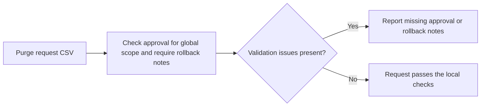

# Edge Cache Purge Validator architecture

Validates cache purge requests for scope, approval, and rollback notes.

## Operational boundaries

The documented run evaluates the bundled sample locally. Results depend on the quality and scope of the input. The demo makes no live infrastructure changes.
